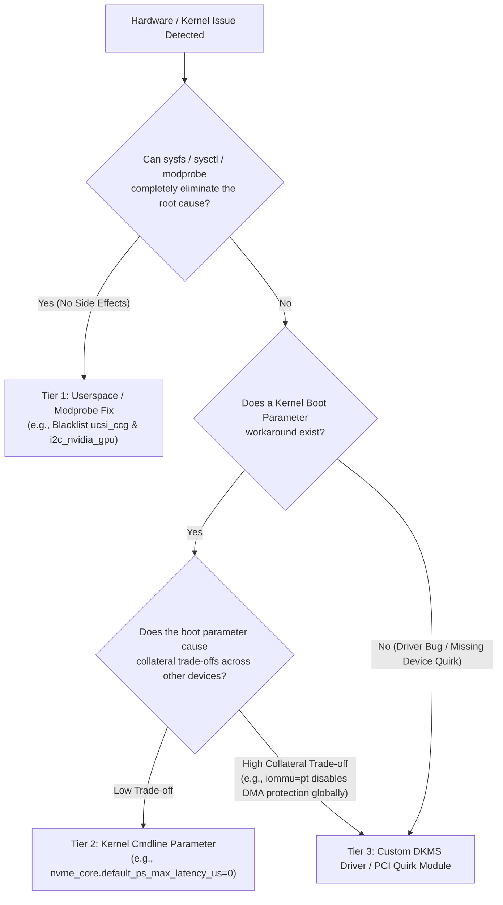

# Alienware m17 R1 (`mothership`) Stabilization, Diagnostic & Driver Advisory Suite — Master Plan

**Target System:** Alienware m17 (`0DG9D5`, BIOS `2.21.1`)  
**OS / Kernel:** Linux Mint 22.x / Ubuntu 24.04 Noble (`Linux 7.0.0-42-generic` HWE)  
**Project Root:** `/var/www/aw-m17-diag`

---

## 1. Executive Summary & Objectives

Following the root-cause investigation into the two hard system lockups on **October 30, 2026 (20:47:50 CDT)** and **October 31, 2026 (09:32:04 CDT)**, we identified a convergence of hardware-level firmware quirks, Linux kernel driver mismatches, and workload-induced resource exhaustion specific to this workstation's hardware configuration.

This project delivers a two-pronged solution:

1. **Immediate Bash Stabilization Script (`scripts/aw-m17-stabilize.sh`)**  
   A zero-dependency, idempotent, transactional Bash script with `--dry-run` and `--rollback` support that immediately neutralizes the crash triggers (NVMe APST controller drop-offs, swap starvation under 70B+ LLM loads, dead GPU Type-C I2C bus stalls, Intel `i915` HPD workqueue stalls, and Flatpak NVIDIA runtime drift).
2. **`aw-m17-diag` Python Diagnostic, Tuning & Driver Advisory CLI/TUI**  
   A strictly typed (`pyright --strict`), linted (`ruff`), `uv`-managed Python application tailored specifically to the hardware topology of this Alienware m17. It provides real-time telemetry, post-mortem crash analysis, pre-flight checks before launching heavy Ollama/gaming sessions, workload profile switching, and a **Custom Driver & Kernel Quirk Advisory Engine** that determines when an issue warrants a custom DKMS driver patch versus a boot parameter or `sysfs` tweak.

---

## 2. Exact Hardware & Firmware Inventory (`mothership`)

Every check, threshold, and recommendation in `aw-m17-diag` is hardcoded and calibrated against the actual PCI/USB/ACPI devices present on this machine:

| Subsystem | Device / Model | PCI / USB / ACPI ID | Active Kernel Driver | IOMMU Group / IRQ |
| :--- | :--- | :--- | :--- | :--- |
| **Platform / BIOS** | Alienware m17 (`0DG9D5`) | BIOS `2.21.1` (11/22/2023) | `alienware_wmi`, `dell_smbios` | ACPI WMI |
| **CPU** | Intel Core i7-9750H (6C/12T, 2.6–4.5 GHz) | `8086:3ec4` (Coffee Lake-H) | `intel_pstate` (`powersave`) | 45W TDP (PL1=200W MSR / 60W MMIO) |
| **iGPU** | Intel UHD Graphics 630 (CFL GT2) | `00:02.0` `[8086:3e9b]` | `i915` | Group 0 / IRQ 156 |
| **dGPU** | NVIDIA GeForce RTX 2070 Max-Q (8 GB GDDR6) | `01:00.0` `[10de:1f10]` (rev a1) | `nvidia` (`595.99.02`), `nvidia_drm` | Group 2 / IRQ 152 (90W Cap) |
| **dGPU Audio** | NVIDIA TU106 HD Audio Controller | `01:00.1` `[10de:10f9]` | `snd_hda_intel` | Group 2 |
| **dGPU USB xHCI** | NVIDIA TU106 USB 3.1 Host Controller | `01:00.2` `[10de:1ada]` | `xhci_hcd` | Group 2 |
| **dGPU Type-C UCSI** | NVIDIA TU106 USB Type-C UCSI Controller | `01:00.3` `[10de:1adb]` | `i2c_nvidia_gpu`, `ucsi_ccg` | Group 2 (Unwired / Failing) |
| **NVMe SSD** | Inland QN450 1TB (Silicon Motion SM2268XT) | `6e:00.0` `[126f:2268]` (rev 03) | `nvme` (FW `Z0302B00`) | Group 16 / IRQ 142, 149 (12 Queues) |
| **Ethernet** | Qualcomm Atheros Killer E2500 Gigabit NIC | `6f:00.0` `[1969:e0b1]` (rev 10) | `alx` | Group 17 |
| **Wi-Fi** | Qualcomm Atheros QCA6174 802.11ac | `70:00.0` `[168c:003e]` (rev 32) | `ath10k_pci` (`WLAN.RM.4.4.1-00309`) | Group 18 / IRQ 155 |
| **Touchpad** | Synaptics Precision I2C Touchpad | `MSFT0001:01` `06CB:CCA6` | `hid_multitouch` / `i2c_hid_acpi` | PCH I2C (`00:15.0`/`00:15.1`) |
| **AlienFX LED** | Alienware ELC LED Controller | USB `187c:0550` (Bus 1 Dev 3) | `usbhid` | USB 2.0 Root Hub |

---

## 3. Catalog of Hardware Minefields, Firmware Bugs & Crash Vectors

The diagnostic engine will continuously audit the following **8 machine-specific minefields** discovered in the system logs:

### Minefield 1: Silicon Motion SM2268XT (`[126f:2268]`) NVMe Controller Drop-Offs & Firmware Quirks
* **Symptoms in Logs:**
  * `nvme nvme0: bad crto:14 cap:8100030f00100ff`
  * `nvme nvme0: allocated 64 MiB host memory buffer (1 segment)`
  * `nvme nvme0: using unchecked data buffer`
  * `block nvme0n1: No UUID available providing old NGUID`
  * `hwmon3` (`nvme`) reports bogus maximum temperature thresholds: `temp2_max = 65261850` (`65,261.85°C`, raw `0xFFFE` Kelvin).
  * Complete OS freeze with NULL-padded `/var/log/syslog` during burst I/O transitions (`flatpak update` OSTree writes and heavy swap/model paging).
* **Root Cause:** The Inland QN450 uses a DRAM-less Silicon Motion SM2268XT controller relying on a 64 MiB Host Memory Buffer (HMB) in system RAM and reporting non-standard `CRTO` (Controller Ready Timeout) registers. With Linux's default `nvme_core.default_ps_max_latency_us=100000`, the controller enters deep Autonomous Power State Transitions (APST) and fails to wake up on rapid I/O queue bursts, dropping off PCIe bus `6e:00.0` and instantly wedging the root filesystem.

### Minefield 2: Qualcomm Atheros QCA6174 (`[168c:003e]`) Intel VT-d DMAR Write Fault Floods
* **Symptoms in Logs:**
  * `DMAR: DRHD: handling fault status reg 2`
  * `DMAR: [DMA Write NO_PASID] Request device [70:00.0] fault addr 0xfe975000 [fault reason 0x05] PTE Write access is not set` (47–60+ bursts per boot).
* **Root Cause:** Intel IOMMU defaults to `Translated` domain mode. The `ath10k_pci` driver maps Copy Engine (CE) ring buffers using `DMA_TO_DEVICE` (read-only in IOMMU page tables), or unmaps RX buffers while the QCA6174 firmware (`WLAN.RM.4.4.1-00309`) still writes completion status back over DMA. The IOMMU blocks the write and fires hardware fault interrupts (`dmar_fault`), risking PCIe bus lockups and Wi-Fi firmware crashes under load.

### Minefield 3: Swap Starvation & Page-Reclaim Livelock Under 70B+ LLM Workloads
* **Symptoms in Logs:**
  * `system memory: total="62.6 GiB" free="59.0 GiB" free_swap="1.6 MiB"`
  * `llama-server terminated: signal: killed` followed by total system lockup during a 43,336-token prompt evaluation on `north-mini-code-1.0`.
* **Root Cause:** The system has 64 GB RAM but only a **2.0 GB `/swapfile`**, coupled with default `vm.swappiness=60` and `vm.dirty_ratio=20`. Loading a 75 GB model (`nemotron-3.5-super:120b`) via `mmap` saturates physical RAM and fills the 2 GB swapfile to 99.9%. Subsequent multi-gigabyte KV-cache and compute graph allocations trigger kernel direct-reclaim thrashing against the SM2268XT NVMe drive.

### Minefield 4: NVIDIA Turing Unwired Type-C UCSI Controller (`01:00.3` `[10de:1adb]`)
* **Symptoms in Logs:**
  * `nvidia-gpu 0000:01:00.3: i2c timeout error e0000000`
  * `ucsi_ccg 5-0008: i2c_transfer failed -110`
  * `ucsi_ccg 5-0008: probe with driver ucsi_ccg failed with error -110`
* **Root Cause:** On the Alienware m17 R1 motherboard, USB-C / Thunderbolt 3 is wired through the Intel controller, leaving the RTX 2070's internal Cypress CCGx controller (`01:00.3`) unconnected. Probing `ucsi_ccg` and `i2c_nvidia_gpu` causes a ~5-second I2C bus timeout on every boot and power transition.

### Minefield 5: Intel `i915` Hot-Plug Detection (HPD) Workqueue Stalls
* **Symptoms in Logs:**
  * `workqueue: output_poll_execute hogged CPU for >10000us 1027 times, consider switching to WQ_UNBOUND`
  * `workqueue: i915_hpd_poll_init_work [i915] hogged CPU for >10000us 1027 times, consider switching to WQ_UNBOUND`
* **Root Cause:** On hybrid Intel UHD 630 + NVIDIA RTX 2070 Optimus laptops, `drm_kms_helper` polls display connectors every 10 seconds on a CPU-bound kernel workqueue, blocking CPU cores for >10ms per poll (over 1,000 times per night) and causing latency spikes.

### Minefield 6: NVIDIA DRM GEM Memory Pinning Errors & Flatpak Driver Drift
* **Symptoms in Logs:**
  * `[drm:__nv_drm_nvkms_gem_obj_init [nvidia_drm]] *ERROR* [nvidia-drm] [GPU ID 0x00000100] Failed to get memory pages for NvKmsKapiMemory`
  * Steam Flatpak errors: `glx: failed to create dri3 screen`, `failed to load driver: nvidia-drm`.
* **Root Cause:** Version mismatch between host kernel driver (`595.99.02`) and Flatpak GL runtime (`org.freedesktop.Platform.GL.nvidia-595-91-07`), plus `nvidia_drm` modeset GEM buffer allocation contention.

### Minefield 7: CPU Power Limit (RAPL) Discrepancy & Broken ACPI Thermal Trip Point
* **Symptoms in Logs:**
  * `ACPI: thermal: [Firmware Bug]: Invalid critical threshold (-274000)`
  * `ENERGY_PERF_BIAS: Set to 'normal', was 'performance'`
  * MSR RAPL (`intel-rapl:0`) long-term PL1 is set to **200W** (`200000000` uW) while MMIO RAPL (`intel-rapl-mmio:0`) PL1 is **60W**, PL2 is **90W**, and Peak Power is **170W** on a 45W nominal i7-9750H.
* **Root Cause:** BIOS `2.21.1` exposes a corrupted `-274°C` (`0` Kelvin) critical threshold on `thermal_zone0` and leaves MSR PL1 uncapped at 200W. Under sustained 100% AVX2 + 90W GPU CUDA loads (like Ollama prompt evaluation), VRMs and shared heatpipes face steep thermal spikes if `thermald`, `intel-rapl-mmio`, and `alienware_wmi` fan boost (`fan1_boost`, `fan2_boost`) are not coordinated.

### Minefield 8: Alienware/Dell WMI Firmware Gaps, Killer E2500 VPD & Touchpad Jumps
* **Symptoms in Logs:**
  * `wmi_bus wmi_bus-PNP0C14:05: [Firmware Bug]: WQBC data block query control method not found`
  * `wmi_bus wmi_bus-PNP0C14:05: [Firmware Bug]: WMBD method block execution control method not found`
  * `dell-smbios A80593CE-A997-11DA-B012-B622A1EF5492: WMI SMBIOS userspace interface not supported(0)`
  * `pci 0000:6f:00.0: [Firmware Bug]: disabling VPD access (can't determine size of non-standard VPD format)`
  * `touchegg[824]: libinput error: event6 - MSFT0001:01 06CB:CCA6 Touchpad: kernel bug: Touch jump detected and discarded.`

---

## 4. Custom Driver & Kernel Modification Advisory Engine

A core requirement of `aw-m17-diag` is determining **when a custom driver, DKMS module, or kernel source patch is the superior engineering solution** versus a blunt kernel boot parameter or userspace configuration.

### 4.1 Decision Matrix: Config vs. Boot Param vs. Custom Driver



### 4.2 Concrete Custom Driver / DKMS Candidates Evaluated by `aw-m17-diag`

The utility's `driver-advisor` module will inspect the running kernel, active modules, and hardware error counters, and provide specific build/patch recommendations (including generating ready-to-compile DKMS skeletons in `/var/www/aw-m17-diag/dkms-candidates/`):

#### Candidate 1: `ath10k-dmar-fix` (Surgical Fix for QCA6174 `[168c:003e]` DMAR Faults)
* **Why the Boot Parameter (`iommu=pt`) is Suboptimal:**  
  Passing `iommu=pt` on the kernel command line puts **every PCIe device in the laptop** into IOMMU passthrough mode, disabling Intel VT-d DMA isolation system-wide just because the Qualcomm Wi-Fi card (`70:00.0`) has broken DMA direction flags.
* **Custom Driver / Kernel Module Solutions:**
  * **Option 1A (Lightweight PCI Quirk / IOMMU Identity Module):** A small out-of-tree kernel module or upstream PCI quirk (`DECLARE_PCI_FIXUP_HEADER(PCI_VENDOR_ID_ATHEROS, 0x003e, ...)`) that requests an identity (passthrough) IOMMU domain *exclusively* for device `0000:70:00.0` (IOMMU Group 18), leaving full VT-d DMA protection active on all other PCIe devices.
  * **Option 1B (DKMS Patched `ath10k_pci`):** Patching `drivers/net/wireless/ath/ath10k/ce.c` and `pci.c` where Copy Engine source rings are mapped with `DMA_TO_DEVICE` to instead use `DMA_BIDIRECTIONAL`. This sets the Write permission bit (`PTE Write`) in Intel VT-d page tables for those ring descriptors, completely eliminating `[fault reason 0x05] PTE Write access is not set` while keeping full strict IOMMU translation enabled!

#### Candidate 2: `nvme-smi2268xt-quirk` (Targeted Quirk & Hwmon Sanitizer for `[126f:2268]`)
* **Why the Global Boot Parameter (`nvme_core.default_ps_max_latency_us=0`) is a Blunt Instrument:**  
  1. It disables APST globally for *all* NVMe drives (including any secondary M.2 SSD installed later).
  2. It does **not** fix the `bad crto:14 cap:8100030f00100ff` timeout calculation, the `No UUID available providing old NGUID` warning, or the corrupted `65,261.85°C` (`0xFFFE` K) sensor limits in `nvme-hwmon`.
* **Custom Driver / DKMS Solution:**
  * A targeted DKMS `nvme` patch (or Kprobe/livepatch module) that:
    1. Adds `{ PCI_VDEVICE(SMI, 0x2268), .driver_data = NVME_QUIRK_NO_DEEPEST_PS | NVME_QUIRK_BOGUS_NID }` to `nvme_id_table` in `drivers/nvme/host/pci.c` so only the Silicon Motion SM2268XT is prevented from entering lethal deep sleep states while preserving shallow power states (or disabling APST per-device).
    2. Filters `0xFFFE` (`65261850` m°C) unimplemented temperature registers in `drivers/nvme/host/hwmon.c` so monitoring tools (`sensors`, `btop`, `thermald`) receive accurate `Composite`, `Sensor 1` (NAND), and `Sensor 2` (Controller) thresholds (`85°C` max / `92°C` crit).

#### Candidate 3: `aw-m17-ec-thermal` (Alienware WMI Fan Curve & Hybrid Power Coordinator)
* **Why Default `alienware_wmi` + `thermald` is Incomplete:**  
  1. `thermal_zone0` reports `Invalid critical threshold (-274000)`.
  2. `intel-rapl:0` (MSR) defaults to a 200W PL1 limit while `intel-rapl-mmio:0` is 60W.
  3. The kernel's `alienware_wmi` driver exposes `fan1_boost` (CPU Fan) and `fan2_boost` (GPU Fan) in `/sys/class/hwmon/hwmon5`, as well as `/sys/firmware/acpi/platform_profile`, but does **not** respond to NVMe Controller temperatures (`hwmon3` Sensor 2) or combined CPU AVX2 + GPU CUDA power draw.
* **Custom Solution:**
  * A user-space/kernel coordination daemon (and optional `alienware-wmi` DKMS patch) integrated into `aw-m17-diag` that monitors CPU package power (`intel-rapl`), GPU temperature/power (`NVML`), and SM2268XT controller temperature (`hwmon3/temp3_input`), dynamically adjusting `platform_profile`, `fan1_boost`/`fan2_boost`, and synchronizing MSR PL1/PL2 with MMIO PL1/PL2.

#### Candidate 4: `i915` Unbound HPD Workqueue Patch (vs. `drm_kms_helper.poll=0`)
* **Comparison:**  
  * **Tier 1/2 Fix:** Setting `/sys/module/drm_kms_helper/parameters/poll` to `N` (or kernel param `drm_kms_helper.poll=0`) immediately stops the `output_poll_execute` CPU hogging at zero cost unless hot-plugging legacy VGA/DVI adapters without HPD pins.
  * **Tier 3 Driver Fix:** The diagnostic tool will verify if `drm_kms_helper.poll=0` eliminates both `output_poll_execute` and `i915_hpd_poll_init_work` stalls, and only recommend a kernel workqueue `WQ_UNBOUND` patch if HPD interrupts still trigger bound workqueue stalls on external DisplayPort/HDMI monitors.

---

## 5. Deliverable 1: Immediate Bash Stabilization Script (`scripts/aw-m17-stabilize.sh`)

Before running heavy workloads again, `scripts/aw-m17-stabilize.sh` will provide a safe, immediate, idempotent remediation with full backup and rollback support.

### 5.1 Features & Safety Guarantees
* **Strict Bash Mode:** `set -euo pipefail`, root privilege verification, lockfile protection.
* **Modes:**
  * `--check` / `--dry-run`: Audits current system state and prints exact diffs/commands without modifying anything.
  * `--apply`: Backs up all modified configuration files to `/var/backups/aw-m17-diag/<timestamp>/` and applies fixes idempotently.
  * `--rollback <timestamp>`: Restores previous configuration backups and regenerates GRUB/initramfs.

### 5.2 Immediate Remediation Actions
1. **Kernel Command Line (`/etc/default/grub`):**
   * Appends `nvme_core.default_ps_max_latency_us=0` (prevents SM2268XT APST bus drop-offs).
   * Appends `iommu=pt` (immediate stopgap for `ath10k_pci` DMAR write faults until Candidate 1 DKMS/quirk is built, if desired).
   * Appends `drm_kms_helper.poll=0` (prevents `output_poll_execute` 10ms CPU stalls).
   * Runs `update-grub`.
2. **Runtime Sysfs Immediate Application (No-Reboot Partial Relief):**
   * Writes `0` to `/sys/module/nvme_core/parameters/default_ps_max_latency_us` immediately so the NVMe drive is protected even before rebooting.
   * Writes `N` to `/sys/module/drm_kms_helper/parameters/poll`.
3. **Swap Expansion (`/swapfile`):**
   * Checks current `/swapfile` size (currently 2 GiB).
   * Safely turns off swap (`swapoff /swapfile`), allocates a **32 GiB** (or configurable `--swap-size 64G`) contiguous swapfile (`fallocate` / `dd`), sets `chmod 600`, formats with `mkswap`, and re-enables with `swapon`.
4. **VM & Memory Pressure Sysctl Tuning (`/etc/sysctl.d/99-aw-m17-workstation.conf`):**
   * `vm.swappiness = 10` (prefer keeping active application pages in 64 GB RAM; only swap cold pages).
   * `vm.vfs_cache_pressure = 50`
   * `vm.dirty_background_ratio = 5` & `vm.dirty_ratio = 10` (prevents massive multi-gigabyte dirty page writeback tsunamis that stall the DRAM-less SM2268XT NVMe controller).
5. **Blacklist Unwired NVIDIA Type-C UCSI Controller (`/etc/modprobe.d/aw-m17-blacklist.conf`):**
   * Blacklists `ucsi_ccg` and `i2c_nvidia_gpu` to eliminate the `01:00.3` I2C timeout (`-110`) on boot.
6. **CPU RAPL Power Limit Sanity Check:**
   * Clamps MSR RAPL `intel-rapl:0` PL1 from the unsafe `200W` default down to match MMIO RAPL (`60W`–`65W` sustained, `90W` short-term burst).

---

## 6. Deliverable 2: `aw-m17-diag` Python Diagnostic & Tuning Suite

### 6.1 Toolchain & Quality Standards
* **Package & Environment Manager:** `uv` (`pyproject.toml` + `uv.lock`, Python 3.12+).
* **Type Checking:** `pyright` in `strict` mode (`typeCheckingMode = "strict"`, zero `Any`, typed `dataclass` / `Pydantic` models for all hardware collectors).
* **Linting & Formatting:** `ruff` (`select = ["E", "F", "W", "I", "UP", "B", "SIM", "ANN", "RUF", "PT", "S"]`).
* **Dependencies:**
  * `typer` — Structured, self-documenting CLI subcommands.
  * `rich` — Color-coded tables, status panels, live TUI dashboard, and diff views.
  * `psutil` — Cross-checked process, memory, swap, and CPU telemetry.
  * `pytest` — Unit tests with mocked `/sys`, `/proc`, and `journalctl` fixtures.

### 6.2 Project Directory Structure

```text
/var/www/aw-m17-diag/
├── PLAN.md                          # This architectural & engineering plan
├── pyproject.toml                   # uv project, ruff, pyright (strict), and pytest config
├── README.md                        # Usage documentation & quickstart
├── scripts/
│   └── aw-m17-stabilize.sh          # Immediate Bash stabilization script (--dry-run / --apply / --rollback)
├── dkms-candidates/                 # Generated/maintained custom driver patch templates
│   ├── ath10k-dmar-fix/             # Patch/module for QCA6174 [168c:003e] DMA_BIDIRECTIONAL / IOMMU quirk
│   └── nvme-smi2268xt-quirk/        # Patch/module for SM2268XT [126f:2268] APST & hwmon temp clamp
├── src/
│   └── aw_m17_diag/
│       ├── __init__.py
│       ├── cli.py                   # Typer CLI entry point (audit, crash-report, preflight, profile, driver-advisor, watch)
│       ├── models.py                # Strictly typed dataclasses / enums for health checks, hardware state, and advisories
│       ├── collectors/
│       │   ├── __init__.py
│       │   ├── storage.py           # NVMe APST latency, SM2268XT CRTO/HMB logs, hwmon3 composite/controller temps
│       │   ├── memory.py            # RAM, Swap headroom, zram/zswap, dirty page ratios, OOM/llama-server kill history
│       │   ├── pcie_iommu.py        # DMAR fault counter, IOMMU domain mode, ath10k [168c:003e] & alx [1969:e0b1] status
│       │   ├── gpu_display.py       # NVIDIA 2070 Max-Q NVML/SMI, ucsi_ccg timeout check, i915 HPD poll, Flatpak GL sync
│       │   ├── thermal_power.py     # Coretemp, alienware_wmi fans/boost, ACPI platform_profile, MSR vs MMIO RAPL limits
│       │   └── crash_forensics.py   # Boot history analyzer (journalctl --list-boots, NULL byte detector, abrupt stop finder)
│       ├── engine/
│       │   ├── __init__.py
│       │   ├── evaluator.py         # Rules engine scoring system health & flagging active minefields
│       │   ├── driver_advisor.py    # Evaluates Tier 1 vs Tier 2 vs Tier 3 (custom DKMS driver) recommendations
│       │   └── profiles.py          # Workload profile manager (ollama-heavy, gaming-prime, balanced-daily, quiet-battery)
│       └── ui/
│           ├── __init__.py
│           ├── console.py           # Rich report formatters, tables, and actionable remediation panels
│           └── dashboard.py         # Live TUI monitor (CPU/GPU/NVMe Controller Temp, Swap, DMAR faults, Fan RPM/Boost)
└── tests/
    ├── __init__.py
    ├── test_collectors.py
    ├── test_driver_advisor.py
    └── test_evaluator.py
```

### 6.3 Core CLI Subcommands

1. **`aw-m17-diag audit`**  
   Runs a complete 360-degree hardware, kernel, firmware, and configuration inspection across all 8 minefields. Outputs a structured `rich` report grading each subsystem (`PASS`, `WARN`, `CRITICAL`) with exact current vs. optimal values.
2. **`aw-m17-diag crash-report [--boots N]`**  
   Inspects the last `N` boots via `journalctl` and `last`, automatically identifying unclean shutdowns, abrupt journal cutoffs, NULL-byte log corruption in `/var/log/syslog`, DMAR fault spikes, `llama-server` `SIGKILL` events, and GPU/NVMe errors immediately preceding a freeze.
3. **`aw-m17-diag preflight [--workload ollama|gaming] [--model-size-gb N]`**  
   Run before starting an overnight Ollama job or gaming session:
   * Verifies NVMe APST is disabled (`default_ps_max_latency_us == 0`).
   * Calculates whether `Physical Free RAM + Free Swap` safely accommodates the target LLM model size + KV cache with a 15% safety margin.
   * Verifies `vm.dirty_ratio` and `vm.swappiness` are tuned to prevent NVMe writeback stalls.
   * Checks Flatpak NVIDIA driver alignment (`host 595.99.02` vs `flatpak org.freedesktop.Platform.GL.nvidia-*`) for Steam.
   * Checks CPU RAPL PL1/PL2 limits and thermal headroom.
4. **`aw-m17-diag driver-advisor [--export-dkms]`**  
   Analyzes every hardware quirk on the system and reports:
   * Which issues are currently mitigated by blunt boot parameters (e.g., `iommu=pt`, global APST disablement).
   * Which issues are candidates for surgical **Tier 3 Custom DKMS / Kernel Quirk Modules** (`ath10k-dmar-fix`, `nvme-smi2268xt-quirk`, `aw-m17-ec-thermal`).
   * Detects when a kernel update (e.g., `7.0.0-42` -> `7.0.0-43`) has occurred and whether custom modules or quirks need rebuilding.
   * With `--export-dkms`, writes out the C source, `Makefile`, and `dkms.conf` for the custom quirk modules into `dkms-candidates/`.
5. **`aw-m17-diag profile [show | set <name>]`**  
   Dynamically dials in hardware settings for the active workload:
   * **`ollama-heavy`**: Sets ACPI `platform_profile` to `balanced-performance`, clamps MSR RAPL PL1 to 65W / PL2 to 85W (preventing thermal trip during multi-hour AVX2+CUDA runs), sets `vm.swappiness=10`, pre-stages fan boost if NVMe Sensor 2 (Controller) exceeds `65°C`.
   * **`gaming-prime`**: Sets `platform_profile` to `balanced-performance`, verifies NVIDIA PRIME offload & Flatpak GL sync, disables `drm_kms_helper` polling to eliminate 10ms frame-time spikes.
   * **`balanced-daily`**: Sets `platform_profile` to `balanced`, MSR PL1 to 45W / PL2 to 75W, quiet fan curve.
   * **`powersave`**: Sets `platform_profile` to `quiet`/`cool`, CPU EPP to `power`, MSR PL1 to 25W.
6. **`aw-m17-diag watch`**  
   A live terminal dashboard (`rich.live`) displaying real-time metrics that standard tools miss:
   * NVMe **Controller Temp (`Sensor 2`)** vs. NAND Composite Temp (`hwmon3`) — crucial because DRAM-less SM2268XT controllers throttle/lock up when Sensor 2 overheats even while NAND temp looks cool.
   * Live DMAR / IOMMU fault counter (`dmesg` stream).
   * CPU Package Power (W) vs. MSR/MMIO RAPL limits & throttling flags.
   * GPU Power (W), VRAM, Temp, and P-state.
   * `alienware_wmi` CPU & GPU Fan RPMs and boost states.
   * RAM + Swap pressure and dirty page writeback backlog (`nr_dirty`).

---

## 7. Phased Implementation & Verification Roadmap

Once you approve this plan, we will execute it in four clean phases:

### Phase 1: Immediate Bash Stabilization Script (`scripts/aw-m17-stabilize.sh`)
1. Write `scripts/aw-m17-stabilize.sh` with `--check`, `--apply`, and `--rollback`.
2. Validate syntax with `bash -n` and run `scripts/aw-m17-stabilize.sh --check` to show the exact pending system changes.

### Phase 2: Python Project Scaffolding (`uv` + `Pyright` + `Ruff`)
1. Initialize `/var/www/aw-m17-diag/pyproject.toml` with `uv`, configuring `ruff` and `pyright` (`strict` mode).
2. Implement `models.py` and the 6 hardware/forensic collectors (`storage.py`, `memory.py`, `pcie_iommu.py`, `gpu_display.py`, `thermal_power.py`, `crash_forensics.py`).

### Phase 3: Diagnostic Engine, Driver Advisor & CLI/TUI
1. Implement `evaluator.py`, `driver_advisor.py` (with DKMS C/Makefile template generation for `ath10k-dmar-fix` and `nvme-smi2268xt-quirk`), and `profiles.py`.
2. Build the `typer` CLI and `rich` console/live TUI views (`audit`, `crash-report`, `preflight`, `driver-advisor`, `profile`, `watch`).

### Phase 4: Strict Verification & Testing
1. Run `uv run ruff check .` and `uv run ruff format --check .` (must pass with 0 warnings/errors).
2. Run `uv run pyright` in strict mode (must pass with 0 errors).
3. Run `uv run pytest` across the test suite.
4. Execute `uv run aw-m17-diag audit`, `crash-report`, and `driver-advisor` against the live system and verify outputs.
